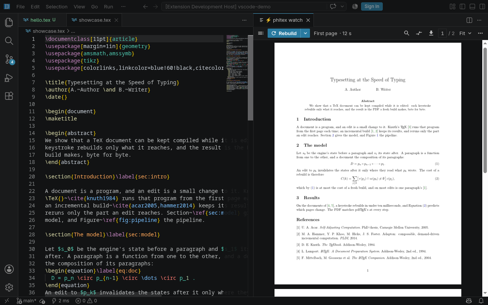

# PhiTeX ⚡ Instant

Instant LaTeX preview for VS Code: the pages update as you type, typeset
by PhiTeX inside VS Code itself. No TeX installation is needed.

PhiTeX is a TeX engine that rebuilds incrementally. An edit re-runs only
what it changed, so ordinary text and headings reach the page in a few
milliseconds.

PhiTeX 1.0's PDF is the one `pdflatex` makes, byte for byte, and the
tests check that after every edit. If you ever find a difference, it's a
bug: please report it.

## Getting started

Open a `.tex` file and press **Ctrl+Alt+P** (**Cmd+Alt+P** on a Mac), or
click the ⚡ button in the editor's title bar. The preview opens beside the
editor.

The first build of a project downloads the TeX packages it uses. They are
kept for next time, so later builds start in seconds.

## What it does

- **Pages as you type**: every edit is typeset at once, with no save and no
  Recompile button.
- **pdfLaTeX and XeLaTeX**: fontspec, unicode-math and polyglossia, with
  TeX Live's OpenType fonts or your own. A `% !TEX program = …` line picks
  the engine, else the preamble does (`phitex.texEngine`).
- **Link previews**: rest the pointer on a `\ref`, an `\eqref` or a
  `\pageref` and a small window shows that spot of the target page. Pin it,
  move it, resize it from its corner.
- **Citation cards**: hover a citation for a card per cited work. A group or
  a range like [1–3] shows every work in it, the one under the pointer
  marked.
- **Back and forward**: follow a link and a Back pill appears, with the
  places you came from; the mouse's back and forward buttons work too.
  Ctrl+click (or a middle click) opens the target in a new preview tab.
- **Source ↔ page**: the word at your cursor is marked on the page.
  Double-click the page to jump to its source; select text on the page to
  select it in the editor.
- **Compare with a past version**: mark a From and a To in the folder's git
  history. The changes are marked on the pages as `latexdiff` marks them,
  and the marks follow your edits. Without git it says what it needs; you
  commit with your own git or Source Control.
- **Problems**: errors and warnings are listed in the preview and underlined
  on the page where they happen. **View log** shows the build's log.
- **Bibliographies and indexes**: BibTeX, biber and makeindex run inside the
  build, so references settle by themselves.
- **minted**: code blocks are highlighted by Pygments, which runs inside the
  extension.
- **Contents**: the document's outline beside the pages.
- **Loading animations**: Settings › Appearance plays each one; pick any
  number, or none (`phitex.opening`).

## Engines

- **builtin** (the default): PhiTeX compiled to WebAssembly, running in VS
  Code's extension host. Nothing to install.
- **phitex watch**: the native `phitex` command, if you have it installed
  (set `phitex.path`).

**Switch Engine** in the command palette changes between them.

## Settings

| Setting | Default | What it does |
|---|---|---|
| `phitex.engine` | `builtin` | Which engine typesets the preview: `builtin` or `phitex watch`. |
| `phitex.path` | `phitex` | The `phitex` command for the `phitex watch` engine: a name on the PATH or a full path. |
| `phitex.texEngine` | `auto` | The builtin engine's TeX: `auto` (a `% !TEX program` line, else the preamble), `pdflatex` or `xelatex`. |
| `phitex.main` | (empty) | The project's main `.tex` file, relative to its folder. Empty: the open file if it has `\documentclass`, else the folder's file that has it. |
| `phitex.follow` | `cursor` | What the pages mark of where you are in the source: `cursor`, `selection` or `dblclick`. |
| `phitex.threads` | `0` | The builtin engine's threads. `0`: one per core of this machine, at most 4. |
| `phitex.darkPdf` | `off` | Dark pages: `off`, `on`, or `theme` (when VS Code's theme is dark). |
| `phitex.opening` | `random` | The loading animations: `random`, `all`, `off`, or those picked, comma separated. |
| `phitex.underline` | `true` | A wavy line on the pages under what each error and warning is about. |
| `phitex.trace` | `false` | Write what the preview does to the PhiTeX output, for a bug report. |

## Privacy

**Your documents never leave your machine.** The typesetter runs inside VS
Code, and so does Python for `minted`.

For a TeX package it doesn't bundle, the extension downloads that package
from **Shelf** (`v1.shelf.phitex.org`, or `shelf-phitex-v1.pages.dev` where
that cannot be reached), static files on Cloudflare Pages. It sends a plain
GET request for the package's file, such as `…/tl2026/h/pgf-3f9a2c41b0de.pack`.
At most once a day it also reads `…/tl2026/release.json` to learn of a newer
package index. No document text, file name of yours, or identifier is sent.
Cloudflare sees the request and your IP address, as with any website. Shelf
keeps no logs of its own.

There are no analytics, no accounts and no tracking.

## Limits

- **LuaLaTeX** projects don't run yet; pdfLaTeX and XeLaTeX do.
- **Images**: PDF, PNG and JPEG figures work.
- **Shell escape** is restricted, as in TeX Live's `pdflatex`, and only
  `minted`'s command runs.
- **Some packages and fonts aren't fully supported yet**, for example
  `microtype`'s font expansion. When the engine stops on something it can't
  do, the problems list names it.
- **Speed varies with what you edit.** Editing a macro that a big TikZ
  picture uses on every point can take a second or more.
- **Very large TikZ documents**: one the size of the TikZ manual (1,180
  pages) runs out of memory in the builtin engine; use `phitex watch`.

## License

AGPL-3.0-only. PhiTeX is made by the Accelerated Connected Computing Lab
(ACCL) at KAUST. Source: <https://github.com/accl-kaust/PhiTeX-frontends>.
